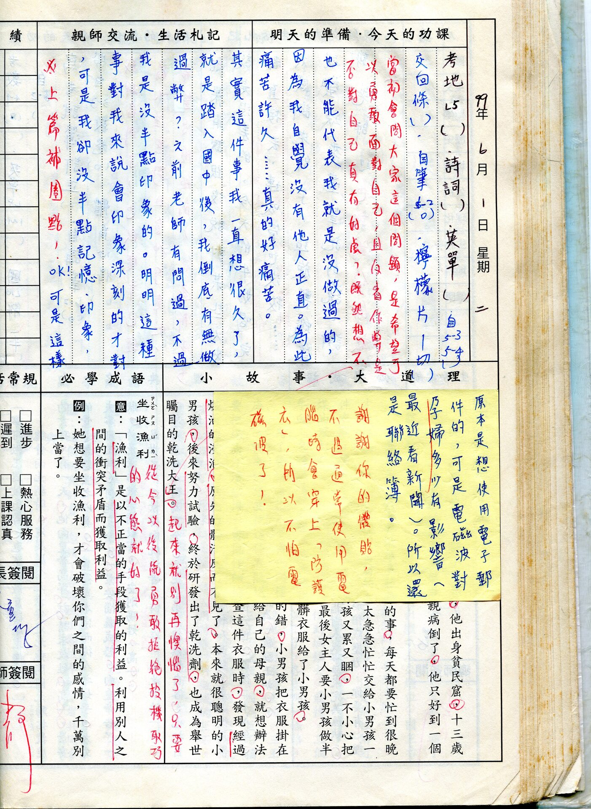
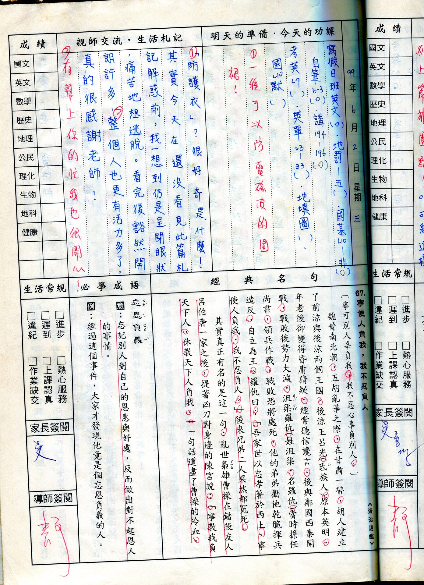

## 正文

　　沉悶的窒息感再次顛覆整個全身。

　　罪孽感也隨之湧上，我簡直無法呼吸。

　　雙臂包覆住整個頭顱，尤其是面上的那雙眼睛，好讓自己不用面對刺眼的天日。

　　但那只會讓我更加羞愧。

{/* truncate */}

> *2010.06.01 札記*  
>　　其實這件是我一直想很久了，就是踏入國中後，我到底有無做過弊？之前老師有問過，不過我是沒半點印象的。
>
>　　明明這種對我來說會印象深刻的才對，可是我卻沒半點記憶、畫面，可是這樣也不能代表我就是沒做過的。
>
>　　因為我自覺沒有他人正直。
>
>　　<strong>為此痛苦許久⋯⋯真的好痛苦。　　　　　</strong>
---
> *2010.06.01 靜老師回覆*  
>　　當初會問大家這個問題，是希望可以勇敢面對自己，且反省作弊是否對自己真有好處？
>
>　　既然想不起來就別再懊惱了。
>
>　　只要從今以後能勇敢拒絕投機取巧的心態就好了。

> *2010.06.02 札記*  
>　　其實今天在還沒看見此篇札記解惑前，我一想到仍是呈閉眼狀，痛苦地想逃脫。
>
>　　看完後豁然開朗許多。
>
>　　整個人也更有活力多了，真的很感謝老師。

---

　　就在五月三十一日上午第三節時，英文老師問誰從來都有無做過弊，我緩緩的舉起手。

　　那是開玩笑的。顆顆顆。

　　但之後老師仍不住提到時，我發現我這玩笑實在很對不起自己。使自己包覆在罪惡的漩渦裡頭。

　　因為又沒有人知道我是開玩笑的嘛。

　　老師這問題也讓我追溯到幾個月前靜老師也曾問過相似的問題，只不過時間是設定在踏入明倫國中後。

　　我那時是沒舉起手的。這可不是開玩笑。

　　假如今日有人問我有做過弊嗎，哪一次。我是回答不出來的。因為我根本完全沒有印象與畫面，我該如何具體的陳述？

　　重點是我想不起來，難道就能代表我沒做過弊了嗎？

　　不，我相信我是卑賤的。

　　我一定有做過弊的。

　　因此，舉了靜老師的那第一次後，我是無法面對我自己的。真的很想逃脫。

　　今天打此篇文章是有目的的。

　　一是 Jing 並不單純。

　　二是 Jing 很痛苦。

　　三是 Jing 想告訴大家這些內幕。

　　我想尋求自身心靈上的彌補，好解脫束縛的枷鎖。

　　爾後，如有相似問題──我是有做過弊的。

　　但如果你問起我是在哪個考試上作弊，我可是回答不出來的。

　　你可以怒罵我、指責我的不對，因為我不僅對不起自己，也欺騙了各位，沒事幹嘛不承認自己的罪行，還在上課開了大家皆不知內幕的小玩笑扮醜，唉唉唉。

　　或是要對我怎樣都沒關係。但是別打我就好，也別用什麼色情的下流手段，謝謝。因為沒這麼誇張。

　　<strong>不過我的痛苦可不誇張。</strong>

　　那一瞬間，我是如釋重負的。

:::success
## 來自 2026 的回顧

（2026-11-23）
:::

我印象那時有貼在無名小站，可是關於同學的回饋還真的沒什麼印象，還是因為後來太膽小就把這篇給隱藏了呀？  

啊，實在好好想知道當時發出這篇文的後續喔！  

現在回望下來，最大問題可能是在於鎂光燈下冒牌者的不自在感被強烈放大。那時好像英文課上很多人都有誠實地坦承自己作弊，然後我沒有，再加上後來又被老師 cue，於是我就自己貼上一個假清高的標籤，再兀自深陷懊悔，第一次這麼具體地將自己的內耗感受表達出來。  
我長大ㄌ也沒有再如此用文字清晰地描述外在畫面，當初竟然還描述給老師聽，真是非常謝謝老師的接納QQ。  
