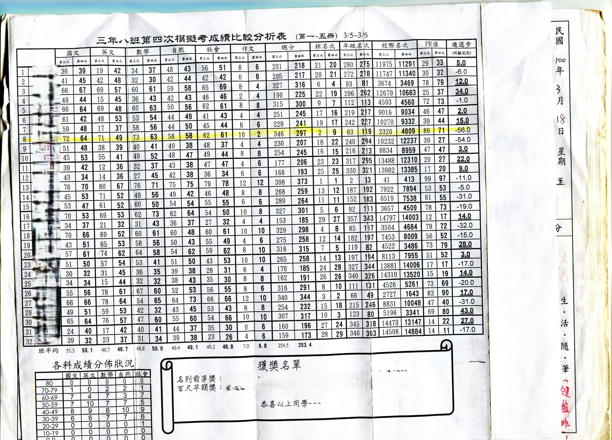

:::info
（本文起稿於 2026-10-23）  
這是我在「[BlogBlog 同樂會 - 2026 年 11 月](https://blogblog.club/party/)」的投稿文章。本月主題是「[**部落格文章（與他們的產地）**](https://blog.giveanornot.com/blogblogparty-blog-posts)」，由 [資工小廢物 - JN](https://blog.giveanornot.com/) 主持。如果你有自己的部落格，歡迎一起來參加！
:::

──

## 對主題本身的雜談

其實一開始點進主題頁面之前，還真的沒想到這次的徵文是這樣的出發點，令人油然升起一種「寫作者本身被好奇、被願意看見」所感到的暖心，謝謝主持人 JN！  

在選題上我很快就有了一些想法，想好好寫一下我與寫作的淵源，主要是想細數成長過程中那些有印象、將某些感受或衝突化做文字的時刻吧。也順便能讓我的「自我介紹」頁面能更臻詳細。  

值得一提的是，我也會將那些被提及、對我有意義的作品一併放上這個部落格，並於各篇補上多年後的今天的回顧心得。這是滿大的一個工程，剛好藉由這次的主題，將過去作品集好好整理一下。  

{/* truncate */}

## 踏上起點線之前：安親班

約莫是小四還小五吧，那時國小安親班有試辦作文班。  
作文老師在第一堂課出的題目是「興趣」。那時我耍白目，隨手寫下「弟弟最喜歡的事情，是放學回到家後，常常衝往廁所大一個很久的便，因此他的興趣就是大便[^poop]」。  
結果當場被老師拿出來訓誡了一番：「到底誰的興趣會是大便啊？」  

老實說，我不太確定是因為被老師拿出來鞭而感到驚慌、羞恥，還是我真的認知到這件事情的嚴重性，也許兩者皆有吧。總之，我開始檢討自己把低級當有趣的行徑。  
從此之後我收起我的調皮，認真投入在作文課上，然後⋯⋯  
嘿，故事發展不會是什麼經由老師培育一番後，接連掃下校內外各個作文獎項ㄉ。  

後來我除了認真切題寫內容外，我還在角色的名字上特別著墨，例如取個「阿里不達」之類唸起來很奇怪、但又不傷大雅能讓同學覺得有趣的名字。內容我還是有認真寫的，不過寫了什麼題目和具體內容是什麼，我根本記不得了。  
我只記得這些好笑的名字，以及被老師拿來當範本誇獎、台下同學笑得很開心的感覺。  

## 寫作的起點：國中 {/* #junior */}

國一下學期，我投稿到校內文學獎散文組的[〈夜車〉](/blog/Driving-Through-the-Night)與〈母親〉，幸運獲選佳作[^literary_award]。那時得知此消息時，第一時間擔心的，反而是上台領獎時會不會被人質疑「怎麼有人可以投兩篇，還一次領兩個獎？」  
我把這個煩惱向靜老師訴說，她告訴我：「那也是因為你有本事囉！」  

拜這個意外的收穫讓我嚐到甜頭，我開始對文字有更多的追求。為了讓我往後的文字能更加洗練，國文課從此搖身成為我的最愛。那時還另有獨立詩詞本以及例行的背誦小考，我最喜歡的是李白的〈將進酒〉，吟誦的過程能感受到快活的音韻，與其灑脫不拘的內容呼應共鳴。~~還有因為數一數二的長～所以背起來很有成就感（不過我在國小時就有背了一點ㄌ）。~~  

不過在課堂上能讓我發揮的機會很少，由於作文窘迫的時間壓力，逼得我總是只能將那些被我揉的皺皺的想法，在響鈴前草率地吐露──成了篇篇事後都不願再回首的文章。  
那時在每一冊的國文習作中，偶爾會有一課的習題是短篇練習，由於不是考試，所以那是少數讓我可以充分醞釀、盡情揮灑的綠洲。自從被我發現了這個練習的存在之後，我每一個新學期最期待的就是拿到習作本時，就先翻閱每一課的習題，看是否有這種寫作練習。  
其中[〈絕美印象〉](/blog/stunning-impression)和[〈小窩銘〉](/blog/An-Inscription-for-My-Little-Nest)便是當時我珍惜至今的作品，前者甚至被老師影印並貼在教室後方的佈告欄，但我實在想不起來該課課文是什麼惹。  

### 網路第一站：無名小站

，於是我開始試著到網路上發展。  
嚴格來說，加入無名小站並<ruby>投入<rt>玩樂</rt></ruby>其中，早在國一上學期就開始了（即文學獎之前），但都我開始會試著把腦中的靈感化為文字寫出來。

那時候就發生了一件事，那也是我至今仍引以為戒的。

### 巴哈姆特

字體 9px
11 px 新細明體

卑斯爾

### 與同儕的關係

請容我小小自豪：收徒弟（小琳）

空想奇談：早起

玉米、小淳、小倪

人錯「己過」

然而我到了高中後，
卻反而不願多提自己這段
儘管我在決定自己的筆名「神經」時，有洞察到自己的某些特徵

## 人才濟濟的高中

這種相形見絀的打擊，到了高中更為嚴重0。
超哥

畢竟你是以現在的標準去審視
司儀學姊，肯定會嚇到吧

印象最深刻的是，亂寫
是我考最爛的一次模擬考

我無法將我的情感揉合進我的句子裡，或者更準確的是：我可能連我的心理需求都不太清楚
再換句話說，我就是寫不出感動自己的文字

在假日班，靜老師誇獎小璦下筆準確，營名適用原子筆但塗改次數極少

### 身處同一所高中的網友

### 從討厭散文到喜歡散文

最
對人的好奇：

[^poop]: 真人真事XDDD。反倒是後來我常便秘，因此羨慕起了弟弟🥹。
[^literary_award]: 三國演義讀書心得組我也有投，那時還有請教〈夜車〉回顧提到的優藍哥，不過最後落選。我記得阿霖也有投並得了佳作！  
