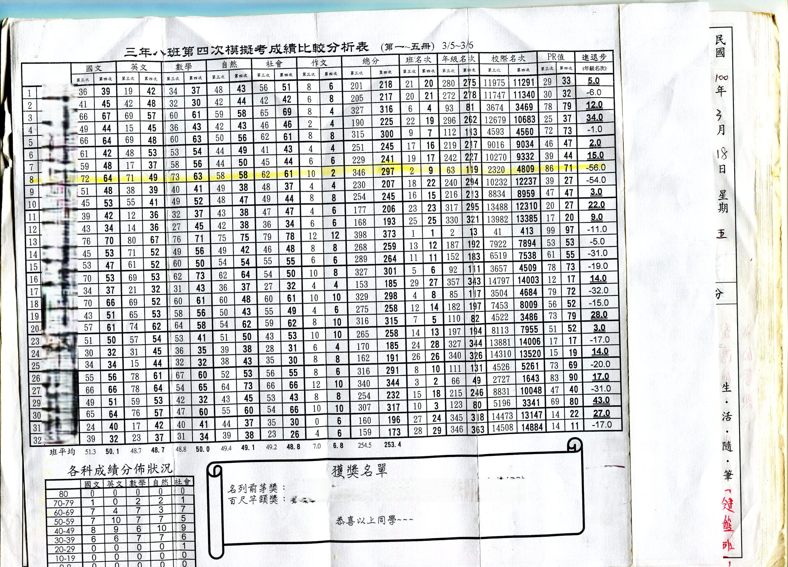

:::info
（本文起稿於 2026-10-23）  
這是我在「[BlogBlog 同樂會 - 2026 年 11 月](https://blogblog.club/party/)」的投稿文章。本月主題是「[**部落格文章（與他們的產地）**](https://blog.giveanornot.com/blogblogparty-blog-posts)」，由 [資工小廢物 - JN](https://blog.giveanornot.com/) 主持。如果你有自己的部落格，歡迎一起來參加！
:::

# 對主題本身的雜談

其實一開始點進主題頁面之前，還真沒想到這次徵文會從這樣的角度出發，一種「寫作者本身被好奇、被願意看見」的暖意油然而生，謝謝主持人 JN！  
順著這份心意，我很快就有了一些想法，我想寫寫自己與寫作的淵源，細數成長過程中，那些有印象、將某些感受或衝突化做文字的時刻；順便也能讓我的「自我介紹」頁面更臻詳細。  

值得一提的是，我也會將此文被提及、對自己別具意義的舊作一併放上部落格，並於各篇補上多年後的今天回顧的心得。這是滿大的一樁工程，剛好藉由這次主題，將過去作品集好好整理一下。  
還是小小提醒，有些作品實在是接近黑歷史的等級，連身為原作者的我也為之汗顏。還請大家（若有興趣）點進去後，留意一下創作的時空背景，先謝謝大家海涵啦！  

{/* truncate */}

# 踏上起點線之前：安親班

約莫是小四還小五吧，那時國小安親班有試辦作文班。  
作文老師在第一堂課出的題目是「興趣」。那時我耍白目，隨手寫下「弟弟最喜歡的事情，是放學回到家後，常常衝往廁所大一個很久的便，因此他的興趣就是大便[^poop]」。  
結果當場被老師拿出來訓誡了一番：「到底誰的興趣會是大便啊？」  

老實說，我不太確定是因為被老師拿出來鞭而感到驚慌、羞恥，還是我真的認知到這件事情的嚴重性，也許兩者皆有吧。總之，我開始檢討自己把低級當有趣的行徑。  
從此之後我收起我的調皮，認真投入在作文課上，然後⋯⋯  
嘿，故事發展不會是什麼經由老師培育一番後，接連掃下校內外各個作文獎項ㄉ。  

後來我除了認真切題寫內容外，我還在角色的名字上特別著墨，例如取個「阿里不達」之類唸起來很奇怪、但又不傷大雅能讓同學覺得有趣的名字。內容我還是有認真寫的，不過寫了什麼題目和具體內容是什麼，我根本記不得了。  
我只記得這些好笑的名字，以及被老師拿來當範本誇獎、台下同學笑得很開心的感覺。  

# 寫作的起點：國中 {/* #junior */}

國一下學期，我投稿到校內文學獎散文組的[〈夜車〉](/blog/Driving-Through-the-Night)與[〈母親〉](/blog/novel-mother)，幸運地雙雙獲選佳作[^literary_award]。那時得知此消息時，第一時間擔心的，反而是上台領獎時會不會被人質疑「怎麼有人可以投兩篇，還一次領兩個獎？」  
我把這個煩惱向靜老師訴說，她告訴我：「那也是因為你有本事囉！」  

拜這次意外的收穫所賜，嚐到甜頭的我開始對文字有更多追求。為了讓往後的文字能更加洗練，國文課搖身成為我的最愛。那時還另有獨立詩詞本以及例行的背誦小考，我最喜歡的是李白的〈將進酒〉，吟誦的過程能感受到快活的音韻，與其灑脫不拘的內容呼應共鳴。~~還有因為數一數二的長～所以背起來很有成就感（其實我在國小時就有背了一點ㄌ）。~~  

那時在每一冊的國文習作中，偶爾會有一課的習題是短篇練習。不是考試，所以它是少數讓我可以充分醞釀、盡情揮灑的綠洲。自從被我發現了這個練習的存在之後，我每一個新學期最期待的就是拿到習作本時，就先翻閱每一課的習題，看是否有這種寫作練習，然後提早著手準備。我人生中很少自信滿滿：但我敢說我絕對是班上最用心投入其中的學生。  
而[〈絕美印象〉](/blog/stunning-impression)和[〈小窩銘〉](/blog/An-Inscription-for-My-Little-Nest)便是當時我珍惜至今的習題作品，前者有被老師影印並貼在教室後方的佈告欄，但我實在想不起來該課課文是什麼ㄌ。  

## 網路第一站：無名小站 {/* #Wretch */}

好奇大家有用過無名小站嗎，又是在多大時註冊的呢？我是在國一開始的！🙋‍♂️  
在文學獎之後，我積極將腦中那些天馬行空的想法化為短篇小說，而平常那些會在站上與我互動的同學們，自然而然就成為我的第一批讀者。[〈蝶之憶〉](/blog/butterfly-memories)和[〈共用、相扣的約定〉](/blog/a-promise-shared-and-interlocked)便是我升上國二後，開始認真投入寫作初期的作品。  
一開始我都借用朋友的名字來創作，一方面是為了讓讀者，即我的朋友們更有共鳴；二來是因為實在想不出來要取什麼名字才好。但因為有些創作屬於言情小說，當時同儕有藉此調侃，而我將該話視為過重的評論，後續演變為嚴重的人際事件。  

後來彼此有順利講開，但多年下來這個事件一直在我心中是個引以為戒的教訓：看待評論的心理調適、人際間玩笑話的拿捏等等，著實也是深刻地上了一課。  

## 巴哈姆特

由於朋友圈中沒有人同在筆耕，對於想要追求更深的交流的我，試著將版圖拓展到網路論壇巴哈姆特。  
──但這理由只是我如今回想下所捏造的。因為理性探究，我根本沒有將無名小站那些短篇創作發到論壇上的記憶與記錄。  

站上有個名為「空想奇談」的哈啦區（或可稱看板？），歡迎各路創作者放上各類型的創作。在那，我交朋友的方式全憑一股熱血：我晚上十點前就寢，隔天一早四點起床，將那些在版面第一頁的新文章[^font]全都讀畢並一一給予善意的感想。  
*既然我沒有能讓人眼睛一亮的文筆能累積粉絲，那我主動釋出善意呢？就能交到喜歡我的朋友了吧*，當時我是這麼想的。  

### 公會

曲蘿幻、小烈、空想奇談版主<u>流血者</u>、月君都是我還有印象的巴友，後來 2010 年 8 月 30 日，我和羊毛興起下建立了與空想奇談同名的巴哈公會。  
不過此時我已是將面對基測的國三生，後來漸漸就淡出事務了。  

### 描寫練習 {/* #practice */}

那時受版主流血者的文風所影響，我也變得非常喜歡練習描寫細節。因為我的個性就是非常喜歡打基礎，將武器磨利直到能大展鋒芒的那天。  
我的寫作資料夾中，還有個滿滿都是高級（至少那時的眼光看來如此）裝潢的照片：  

另一部分也是出於想要擁有高質感的房屋的夢想，我很享受於欣賞擺設與裝潢的小細節，同時帶點奢侈的幻想，幻想此生能有機會住上幾回。同時還要適時地拉回現實，思考要怎樣才能讓我的文字更靠近這些美房。  
[〈本門山上的別墅〉](/blog/villa-on-benmen-mountain)與[〈卑斯爾〉](/blog/bisier-early-landscape)便這個脈絡下的作品。  

## 與同儕的關係

請容我小小自豪：收徒弟（小琳）

玉米、小淳、小倪

然而我到了高中後，
卻反而不願多提自己這段
儘管我在決定自己的筆名「神經」時，有洞察到自己的某些特徵

現在我還能細數當年會來留言的一些朋友們。而且我的創作還真的就停留在那篇文之後，就再也沒有任何的小說創作了。

有點感慨的是，以前總會有一群捧場的朋友們，會看著我那些天馬行空、與我無關的想法；然而如今的我，更重視的是專注在個人的心路歷程等等。但現在大概已經沒有朋友了，當年留下來的朋友少之又少。

而且今年其實在寫那篇文章的時候，我是想要藉由那篇分享給一些好朋友，邀請他們也向我分享些什麼，然而他們也只是寒暄一下，就沒有後續的心得回應了，這讓我覺得真的蠻可惜的。

不過在課堂上能讓我發揮的機會很少，由於作文窘迫的時間壓力，逼得我總是只能將那些被揉得皺皺的想法，在響鈴前草率地吐露──成了篇篇事後都不願再回首的文章。  

## 詩詞與創作欲

[〈鬱金花語，語花之語〉](/blog/the-language-of-tulips)
詩詞，如今為何不創作
我不知道到底該慶幸當年有做這些創作，還是應該反過來覺得，正是因為留下了這些難堪，才讓它成為類似黑歷史的東西，一直糾纏著我，讓我無法再去試著做這方面的創作。  

# 人才濟濟的高中

這種相形見絀的打擊，到了高中更為嚴重。
超哥
親眼看到：所謂認真對待、熱愛文學，會是怎麼的模樣。不過閱讀超哥文字的機會，是在上大學後他偶爾會用 FB 發文才變多的。

畢竟你是以現在的標準去審視
司儀學姊，肯定會嚇到吧

印象最深刻的是，亂寫
是我考最爛的一次模擬考

我無法將我的情感揉合進我的句子裡，或者更準確的是：我可能連我的心理需求都不太清楚
再換句話說，我就是寫不出感動自己的文字
既視感

在假日班，靜老師誇獎小璦下筆準確，營名適用原子筆但塗改次數極少

但貧乏於構思人物間的關係與情感，更別說什麼引人入勝的劇情了；再加上作文和同學相比下相形見絀……於是意識到缺乏才能的我開始不再積極創作。
（現在回頭來看要求國中生的自己寫細膩的東西，或許有點苛刻了，尤其是我這成年人近一年才比較認識情緒與自己的投射。）

## 身處同一所高中的網友

## 與散文的關係
──
最
對人的好奇：

[^poop]: 真人真事XDDD。反倒是後來我常便秘，因此羨慕起了弟弟🥹。
[^literary_award]: 三國演義讀書心得組我也有投，那時還有請教〈夜車〉回顧提到的優藍哥，不過最後落選。我記得阿霖也有投並得了佳作！  
[^font]: 順帶一提，那時有印象的排版字體還是以新細明體居多，分為 9px 小字派與 11 px 端正派（100% 瀏覽大小）。
