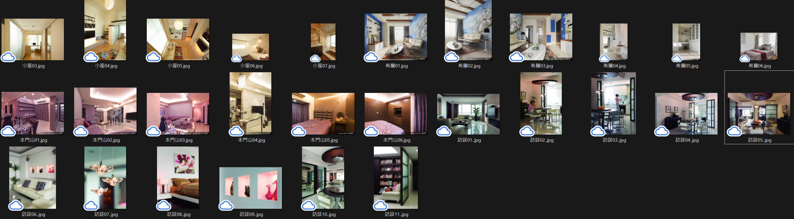
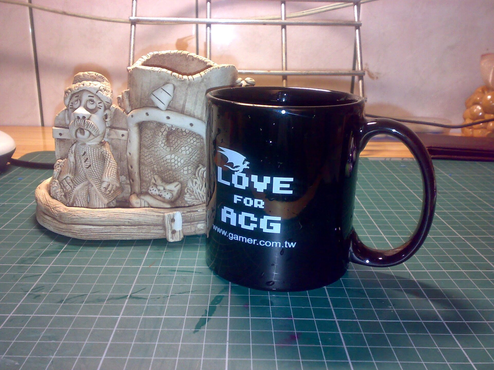

:::info
（本文起稿於 2026-10-23）  
這是我在「[BlogBlog 同樂會 - 2026 年 11 月](https://blogblog.club/party/)」的投稿文章。本月主題是「[**部落格文章（與他們的產地）**](https://blog.giveanornot.com/blogblogparty-blog-posts)」，由 [資工小廢物 - JN](https://blog.giveanornot.com/) 主持。如果你有自己的部落格，歡迎一起來參加！
:::

# 對主題本身的雜談

其實一開始點進主題頁面之前，還真沒想到這次徵文會從這樣的角度出發，一種「寫作者本身被好奇、被願意看見」的暖意油然而生，謝謝主持人 JN！  
順著這份心意，我很快就有了一些想法，我想寫寫自己與寫作的淵源，細數成長過程中，那些有印象、將某些感受或衝突化做文字的時刻；順便也能讓我的「自我介紹」頁面更臻詳細。  

值得一提的是，我也會將此文被提及、對自己別具意義的舊作一併放上部落格，並於各篇補上多年後的今天回顧的心得。這是滿大的一樁工程，也剛好藉由這次主題將過去作品集好好整理一下。  
還是小小提醒，有些作品實在是接近黑歷史的等級，連身為原作者的我也為之汗顏。還請大家（若有興趣）點進去後，留意一下創作的時空背景，先謝謝大家海涵啦！  

{/* truncate */}

# 踏上起點線之前：安親班

約莫是小四還小五吧，那時國小安親班有試辦作文班。  
作文老師在第一堂課出的題目是「興趣」。那時我耍白目，隨手寫下「弟弟最喜歡的事情，是放學回到家後，常常衝往廁所大一個很久的便，因此他的興趣就是大便[^poop]」。  
結果當場被老師拿出來訓誡了一番：「到底誰的興趣會是大便啊？」  

老實說，我不太確定是因為被老師拿出來鞭而感到驚慌、羞恥，還是我真的認知到這件事情的嚴重性，也許兩者皆有吧。總之，我開始檢討自己把低級當有趣的行徑。  
從此之後我收起我的調皮，認真投入在作文課上，然後⋯⋯  
嘿，故事發展不會是什麼經由老師培育一番後，接連掃下校內外各個作文獎項ㄉ。  

後來我除了認真切題寫內容外，我還在角色的名字上特別著墨，例如取個「阿里不達」之類唸起來很奇怪、但又不傷大雅能讓同學覺得有趣的名字。內容我還是有認真寫的，不過寫了什麼題目和具體內容是什麼，我根本記不得了。  
我只記得這些好笑的名字，以及被老師拿來當範本誇獎、台下同學笑得很開心的感覺。  

# 寫作的起點：國中 {/* #junior */}

國一下學期，我投稿到校內文學獎散文組的[〈夜車〉](/blog/Driving-Through-the-Night)與[〈母親〉](/blog/novel-mother)，幸運地雙雙獲選佳作[^literary_award]。那時得知此消息時，第一時間擔心的，反而是上台領獎時會不會被人質疑「怎麼有人可以投兩篇，還一次領兩個獎？」  
我把這個煩惱向[靜老師](/blog/like-dear-wife)訴說，她鼓勵我：「那也是因為你有本事囉！」  

拜這次意外的收穫所賜，嚐到甜頭的我開始對文字有更多追求。為了讓往後的文字能更加洗練，國文課搖身成為我的最愛。那時還另有獨立詩詞本以及例行的背誦小考，我最喜歡的是李白的〈將進酒〉，吟誦的過程能感受到快活的音韻，與其灑脫不拘的內容呼應共鳴。~~還有因為數一數二的長～所以背起來很有成就感（其實我在國小時就有背了一點ㄌ）。~~  

那時在每一冊的國文習作中，偶爾會有一課的習題是短篇練習。不是考試，所以它是少數讓我可以充分醞釀、盡情揮灑的綠洲。自從被我發現了這個練習的存在之後，我每一個新學期最期待的就是拿到習作本時，就先翻閱每一課的習題，看看是否有這種寫作練習，然後提早著手準備。我人生中很少自信滿滿：但我敢說我絕對是班上最用心投入其中的學生。  
而[〈絕美印象〉](/blog/stunning-impression)和[〈小窩銘〉](/blog/An-Inscription-for-My-Little-Nest)便是當時我珍惜至今的習題作品，前者有被靜老師影印並貼在教室後方的佈告欄，但我實在想不起來該課課文是什麼ㄌ。  

## 網路第一站：無名小站 {/* #Wretch */}

好奇大家有用過無名小站嗎，又是在多大時註冊的呢？我是在國一開始的！🙋‍♂️  
在文學獎之後，我積極將腦中那些天馬行空的想法化為短篇小說，而平常那些會在站上與我互動的同學們，自然而然就成為我的第一批讀者。[〈蝶之憶〉](/blog/butterfly-memories)和[〈共用、相扣的約定〉](/blog/a-promise-shared-and-interlocked)便是我升上國二後，開始認真投入寫作初期的作品。  
一開始我都借用朋友的名字來創作，一方面是為了讓讀者，即我的朋友們更有共鳴；二來是因為實在想不出來要取什麼名字才好。但因為有些創作屬於言情小說，當時同儕有藉此調侃，而我將該話視為過重的評論，後續演變為嚴重的人際事件。  

後來彼此有順利講開，但多年下來這個事件一直在我心中是個引以為戒的教訓：看待評論的心理調適、人際間玩笑話的拿捏等等，著實也是深刻地上了一課。  

## 網路第二站：巴哈姆特

由於朋友圈中沒有人同在筆耕，對於想要追求更深的交流的我，試著將版圖拓展到網路論壇巴哈姆特。  
──但這理由只是我如今回想下所捏造的。因為理性探究，我根本沒有將無名小站那些短篇創作發到論壇上的記錄，與記憶。  

站上有個名為「空想奇談」的哈啦區（或可稱看板？），歡迎各路創作者放上各類型的創作。在那，我交朋友的方式全憑一股熱血：我晚上十點前就寢，隔天一早四點起床，將那些在版面第一頁的新文章[^font]全都讀畢並一一給予善意的感想。  
*既然我沒有能讓人眼睛一亮的文筆能累積粉絲，那我主動釋出善意呢？就能交到朋友了吧*。當時我是這麼想的。  

### 公會

<u>曲蘿幻</u>、<u>小烈</u>、空想奇談版主<u>流血者</u>、<u>月君</u>都是我還有印象的巴友，後來 2010 年 8 月 30 日，我和羊毛興起下建立了與空想奇談同名的巴哈公會。  
不過此時我已是將面對基測的國三生，後來漸漸就淡出事務了。  

### 描寫練習 {/* #practice */}

那時受版主流血者的文風所影響，我也變得非常喜歡練習描寫細節。因為我的個性本就熱衷於打基礎，想將武器磨利直到能大展鋒芒的那天。  
我的寫作資料中，還有個存滿高級（至少那時的眼界是如此）裝潢照片的資料夾：  

另一部分也是出於想要擁有高質感房屋的夢想，我很享受欣賞擺設與裝潢的小細節，心裡帶點奢侈的幻想，期盼此生能有機會住上幾回；同時還要適時地拉回現實，思考要怎樣才能讓我的文字更靠近這些美房。  
[〈本門山上的別墅〉](/blog/villa-on-benmen-mountain)與[〈卑斯爾〉](/blog/bisier-early-landscape)便是這個脈絡下的創作。  

### 文字量

關於我創作的狀況與文字量的產出，其實一直都不太高。我歸因於以下兩點：  

- 靈感不足，腦中乍現的只有與故事主軸相關的高潮場景，但最後總是苦惱於如何鋪陳與銜接
- 缺乏耐心，與前一點有關，卡到後來放棄轉頭去寫其他故事了

因此前述對畫面練習的偏好，也是因為寫起來阻力小。至於劇情類的幾乎全軍覆沒，不過還是有少數如[〈臭得有味〉](/blog/a-distinctive-stench)成功用無厘頭的方式快速收尾的。  

對了，因為太缺素材，我還曾經把腦筋動到英文課本上：[〈英課第一冊：第一至第三課〉](/blog/english-textbook-guide-lessons-one-to-three)和[〈英課第一冊：第三至第六課〉](/blog/english-textbook-guide-lessons-three-to-six)，真是太無聊了我XDD。  

### 同人創作 {/* #fan-fiction */}

2010 年 1 月，站上舉辦「奇談盃動漫同人賞」，光是參加獎就有巴哈姆特馬克杯，這個看似小小的獎品對我而言是個大大的契機──彷彿能讓自己的投稿，被具體的獎勵肯定似的。  

那時我正好沉迷 Wii 平台的《海賊王 無限巡航》，於是我便選擇《海賊王 One Piece》作為我的同人背景，開始在多個週末一點一滴累積篇幅，最後寫出五章節共 7900 字左右：  

- [〈吾，至親之子〉](/blog/my-dearest-son-complete)
- [〈吾，至親之子〉特別企劃](/blog/my-dearest-son-special-project)
- [〈吾，至親之子〉後記](/blog/my-dearest-son-afterword)

儘管最後並沒有得名（如預期中的，本就志在參加），但這次「有始有終」的經驗，對我的寫作以及整個人生，無疑是很珍貴的自我實現。  

## 與同儕的關係

回來談談現實的人們吧。那時有印象的同學讀者們，有玉米、小淳、小倪、阿霖、阿嘉，以及──請容深知達克效應的我小小自豪──我的徒妹小琳。  

我實在是想不起來我到底教了什麼、又有什麼能教。不過，能在現實中結交志同道合的朋友，無疑能注入新的寫作動力。但，我記得的還有心酸與失望，因為後來小琳沒多久便放棄這條路了。  

### 為你做不可能的事[^poem]

國二那年我與小霖[^lin]負責升旗降旗時的司儀工作，這個崗位往常都是由女性擔任，因此認識了指導我們的小偲學姐。  
她氣質端莊講話溫柔，而在多次的教導下，我心裡不知不覺間也萌生了類似情愫的東西。但其實我們的相處並非無話不談，我就只是默默地仰慕她而已。  

這股心意漸漸隨著畢業典禮的到來越變越強烈，我自作多情與浪漫地將種種心緒化作詩詞，而[〈鬱金花語，語花之語〉](/blog/the-language-of-tulips)是我人生第一首創作。  
說來好笑，我連小偲學姐未來要前往哪所高中都不知道，我就只是一股腦地將所有 8 首情詩，謄寫在信紙上，緊張不已地在畢業典禮上通通遞給她。  

此刻的我只想說：小偲學姐，希望這份唐突沒有造成困擾，我只想為我當年的莽撞向妳道歉🥹！  

## 作文與無力感

前面提過我喜歡國文課，但其實在課堂上能讓我發揮的機會很少：作文窘迫的時間壓力，逼得我總是只能將那些被揉得皺皺的想法，在響鈴前草率地攤在紙上，成了篇篇事後都不願再回首的文章。  

「*為什麼總是寫得這麼費力呢？*」每每遇到作文，多少都會冒出這個念頭。「有在寫作」這個標籤總會被我自動貼好，然後再將自己和那些作文寫得不錯的同學，在心底暗自較勁一番，最後傷痕累累地將自己歸類為「缺乏才能」。  

國中假日班某次作文練習時，靜老師誇獎小璦同學不僅行文優美，下筆更是準確、塗改次數極少。平時我既尊敬又喜歡的靜老師，好像是第一次當眾這樣表揚學生呢。  
心裡悶悶澀澀的，覺得講臺上的老師距離我好遠好遠，同時想著該如何變得更優秀，好讓自己更靠近老師。不知不覺間，這個事件就被我惦記至今了。  
當時的我，總是無法將多深厚的情感揉合進我的句子裡；或者更準確地說──我連自身的情緒與需求都還模模糊糊的，自然寫不出感動自己的文字[^touching]。  

這種相形見絀的打擊，到了高中更為嚴重。於是我在朋友面前便不願多提自己這段寫作的過去，因為冒牌者的心態總會讓心裡跟著冒出一句「那 Jing 現在看來也不過爾爾嘛。」，那還不如少說一點吧。  

## 創作欲

### 放棄

回顧那些有如尿床回憶般羞恥的詩詞時，我在想，到底該抱持什麼心態？是該慶幸至少留下了青春的痕跡；抑或恰恰相反：正是因為留下了這些難堪，才讓它們像黑歷史般隱隱纏著我，使我再無勇氣嘗試了？  

升上高中後，我深感課業的繁重，於是發佈[〈小小的話〉](/blog/small-announcement)表示停筆。然後，就這麼再也沒有拾回那份創作的欲望了。  

## 後來的寫作

其實國中那時認命不往作家之路邁進後，「寫作」在未來的藍圖中，就變成了「下班後針對社會話題抒發成見」的想像。目前部落格的主題看來⋯⋯也算是莫名相似耶XD。  

不過一路瀏覽眾多舊文下來，我最喜歡的反而不是當初字斟句酌的創作，而是靠近內心的文章，例如[〈作弊〉](/blog/about-cheating)是此生第一次曝光腦中一團混濁的內耗感，這種自我揭露的勇氣與真實，想必多年後還會讓我想再回顧的。  
說到靠近內心，其實我國中還是有篇滿意的作文。那時剛升上國一的弟弟向我請教數學題目，但受知識的詛咒所害，國三的我很快就失去耐心，對他惡言了幾句。  
「早知道就不問你了。」弟弟留下了這句便不歡而散，獨自留在書桌前的我也為此懊悔不已。  
後來這段經歷成為作文的素材，那是我唯一一次，自然、純粹地將情緒流露於稿紙上。雖然現在的我很是後悔當初沒將它備份下來，但我始終牢牢記著完稿後的舒坦，以及這回被靜老師貼在佈告欄上的肯定。  

[^poop]: 真人真事XDDD。反倒是後來我常便秘，因此羨慕起了弟弟🥹。
[^literary_award]: 三國演義讀書心得組我也有投，那時還有請教〈夜車〉回顧提到的優藍哥，不過最後落選。我記得阿霖也有投並得了佳作！  
[^font]: 順帶一提，那時有印象的排版字體還是以新細明體居多，分為 9px 小字派與 11 px 端正派（100% 瀏覽大小）。
[^lin]: 感謝當時靜老師的賞識，是很珍貴的經驗。另位小霖和阿霖是不同人哦！
[^poem]: 那時應該有受吳克群 2008 的〈為你寫詩〉影響XD。
[^touching]: 不過要求國中生的自己寫細膩的東西⋯⋯或許有點苛刻了，尤其是我這成年人近一年才比較認識情緒、陰影與投射等議題。是說還算是有細膩之處啦，我也正是因為洞察到自己的某些特徵，才取了個筆名「神經」！  
