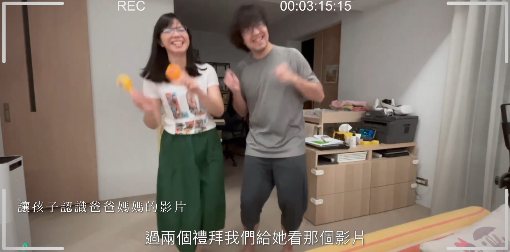

import Head from '@docusaurus/Head';

<Head>
  <meta name="robots" content="noindex, nofollow" />
</Head>

## 消極與積極

歷經 2024 年堪稱人生難關的衝突後，我面對政治輿論的態度漸漸改變了。  

{/* truncate */}

首先我得坦承，每每看見新的議題被拋出來，以我微薄的心力實在是無法全面查證。讀著大家各執的說詞，我甚至懷疑是不是我資質駑鈍，看不懂他人口中的理所當然。  
其中最、最、最讓我厭煩的，是那些撕了又貼的標籤、不理性挑起對立之虞的言論──儘管我有意識到是邪惡的社群演算法在作祟，但仍不免因「世界上還有這麼多仇恨之聲」感到心寒，與疲累。  

種種累積下來，對我的影響具體有二：  
消極面是我開始往心理阻斷的方式去隔絕：我多次有「2026 年不返鄉投票」的念頭，甚至也因此猶豫過 2028 年的，到最後我只拿得出「甘願與這片土地上的人們所做出的選擇一同承擔」的被動底線。  

那我剩餘的積極面呢？  
大概是，如果有人不願理解我的想法與歷程，只根據我單一的行為向我惡言。那我會忿忿地上前與他扭打，然後帶著些許悲傷向他怒吼「**幹⋯⋯幹！還不是你們這群人害的！**」，最後弄得頭破血流[^fight]。  

## 新契機

有時我仍會抱持一絲奢望思索：如今被動且單薄的我，還能依循何種原則將自由意志融入我的那一票呢？  

我先是想起了今年 4 月讀完《人慈》所歷經的那一趟人性希望探討之旅；我再想起了[〈2025 回顧〉](/blog/2025#2-what-valuable-life-lesson-did-you-learn-this-year今年你學到最有價值的一個人生課題是什麼)提及去年 8 月「遠離負能量之人」的啟發；我還想起了近幾年積極投入「認識自己」的志向。  
最終「**我想成為什麼樣的人**」這個伴隨「以終為始」的大哉問浮現出來，然後盤踞心頭。  

從高中排列組合習得的逆向思維，先來排除不要的：*戾氣、刻薄、尖酸、傲慢、缺乏耐心*，這些是我筆撰當下直覺冒出的詞彙。  
反過來冒出的正向特質是**溫暖**。其實在婚禮前後，深刻地體驗過被祝福、被愛包圍，感覺我開始更長出幾分感性了，我也相當欣然地珍惜著。  

真正讓我燃起一點身為選民的熱切，是滑到臺北市長候選人沈伯洋受勵馨採訪，談收養初期的[影片](https://youtu.be/P1yNgO-hw9c?si=AVd3OZKR7dw010Go)。畫面中他和他老婆唱歌跳舞，為的就是讓小孩在未來能更快融入新家。  

老實說「生育」是我這十多年間就偶爾會拿出來自我思考的課題[^baby]，近年我也曾考慮過收養[^cousin]的可能性。最近剛好讀完《為什麼魚不存在》，內文關於血緣的討論更促使我直面隱隱的執念，所以對於沈夫婦那畫面中所流露出的大愛，實在是讓我深深敬佩不已呀！  
還有他開放刑法課程造福無數學子[^cram]，換作是我絕對無法達到此等格局。  
所以我若身為臺北選民，至少能因這兩個我所觀察到的行為特質吻合我目前價值觀，堅定地投下這一票。也因這個起心動念，讓我較有動力返鄉履行公民權利。  

有人或許會嚷嚷，可是可是他之前怎樣怎樣不好──嘿，方便先一起留心**好**的部分嗎？  
所以我也提一下關於現任蔣市長的部分，我最有印象的是頒發市長獎的片段：父子之間合照共擺 Sigma face，那自在的父子互動是還滿有玩味的。  
對ㄌ，我也提一下對所在生活圈的關注：竹北鄭朝方學手語的契機也是我所欣賞的那份溫柔。  

總之，我只是想吐露一下目前的轉變與出發點，也沒有想要鼓吹偶像崇拜什麼的。  
（小提醒：政策也很重要，但不是我這篇文章的重點哦）  

最後的最後，這次我就不說「感謝閱讀至此的您」了，我只想說：感謝願意試著了解至此的您！  

[^baby]: 我應該勉強可如此自稱吧：讀到一半的有《要不要生小孩》，待讀的尚有《後悔當媽媽》。
[^fight]: 我很好奇讀到這段的感受，其實若覺得滑稽也沒關係：我既希望心中那股被逼迫出的憤怒能好好被闡述出來，但又不希望太過沉重，所以最後就有點手殘地寫成這樣XD。
[^cousin]: 我還記得去年服喪期間，帶著痛失阿公阿嬤的傷痛，我和語希、堂弟阿瑋、堂妹小瑀坐在樹下，感念著家庭凝聚力的溫暖下，我好奇地拋出對生育的想法。那時阿瑋說，以前老師給他們看某部電影講述收養的電影很感動他，如果可以的話他也想成為那樣為孤兒帶來希望的人。哇哇著實讓哥哥我自嘆弗如呀！！
[^cram]: BTW，上週讀完《房思琪的初戀樂園》，華麗的詞藻讓我具體地看見補教業權威的可怕。