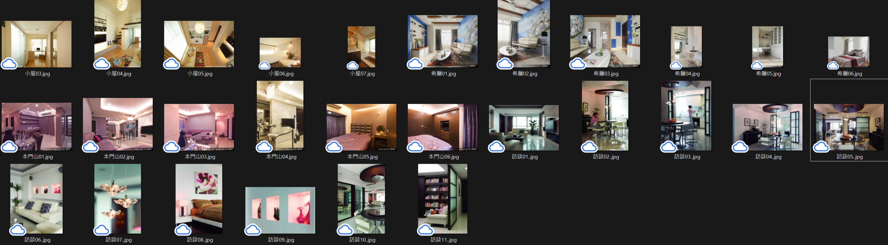

# 〈與寫作的回憶〉：開頭至〈描寫練習〉雙階段潤飾

來源：`blog/2026/2026-10-20_部落格的產地.md`，2026-11-15 最新工作區版本，第 9–75 行，含〈描寫練習〉；三則原註腳隨稿附上。front matter、〈與同儕的關係〉起的後文不改。

輸入原稿 SHA-256：`7dc4ee2a5e718cb2094c817a26640439dd5e85c12ec05b88601f5bf825164434`。

兩版由 [agy-staff](https://github.com/keli-wen/agy-staff/tree/07ab3d1f73167106cc7d2f4bcb07defda6b455f0) 呼叫 `gemini-4-argon-high` 回傳。Codex 負責選取、核對、去除範圍標記與行末空白、另存及推送；原始回覆留在本地。這一輪採用作者最新原稿，沒有沿用上一輪的開頭改稿檔。

## V1：Gemini 4 Argon

agy-staff 任務：`staffer-mwhx0e2q-e5066972`。

本次潤稿保留原稿幽默口語、注音括號與回顧視角，重點消除重複用詞（如疊出的「認真」「同時」「非常喜歡」），理順長句主詞與段落轉折，並嚴格維持事件分寸、推測語氣與所有標記連結。

:::info
（本文起稿於 2026-10-23）
這是我在「[BlogBlog 同樂會 - 2026 年 11 月](https://blogblog.club/party/)」的投稿文章。本月主題是「[**部落格文章（與他們的產地）**](https://blog.giveanornot.com/blogblogparty-blog-posts)」，由 [資工小廢物 - JN](https://blog.giveanornot.com/) 主持。如果你有自己的部落格，歡迎一起來參加！
:::

# 對主題本身的雜談

其實點開主題頁面之前，還真沒想到這次徵文會從這樣的角度出發——一種「寫作者本身被好奇、被願意看見」的暖意油然而生，謝謝主持人 JN！
順著這份心意，我很快就有了方向：想寫寫自己與寫作的淵源，細數成長過程中，那些至今仍有印象、將某些感受或衝突化作文字的時刻；順道也能讓我的「自我介紹」頁面更臻詳細。

值得一提的是，我也會將文中提及、對自己別具意義的舊作一併放上部落格，並在各篇補上多年後回顧的心得。這是滿大的一樁工程，剛好藉由這次主題，將過去的作品集好好整理一番。
不過還是小小提醒，有些作品實在接近黑歷史的等級，連身為原作者的我也為之汗顏。還請大家（若有興趣）點進去後，多留意一下當時創作的時空背景，先謝謝大家海涵啦！

{/* truncate */}

# 踏上起點線之前：安親班

約莫是小四還小五吧，那時國小的安親班有試辦作文班。
作文老師在第一堂課出的題目是「興趣」。那時我耍白目，隨手寫下「弟弟最喜歡的事情，是放學回到家後，常常衝往廁所大一個很久的便，因此他的興趣就是大便[^poop]」。
結果當場被老師拿出來訓誡了一番：「到底誰的興趣會是大便啊？」

老實說，我不太確定當時是因為被老師拿出來鞭而感到驚慌、羞恥，還是我真的認知到這件事情的嚴重性，也許兩者皆有吧。總之，我開始檢討自己把低級當有趣的行徑。
從此之後我收起調皮，認真投入在作文課上，然後⋯⋯
嘿，故事發展不會是什麼經由老師培育一番後，接連掃下校內外各個作文獎項ㄉ。

後來除了乖乖切題行文外，我還喜歡在角色的名字上特別著墨，例如取個「阿里不達」之類唸起來很奇怪、卻不傷大雅又能讓同學覺得有趣的名字。雖然正文一樣有認真寫，不過究竟寫過什麼題目和具體內容，現在根本記不得了。
我只記得這些好笑的名字，以及被老師拿來當範本誇獎、台下同學笑得很開心的感覺。

# 寫作的起點：國中 {/* #junior */}

國一下學期，我投稿到校內文學獎散文組的[〈夜車〉](/blog/Driving-Through-the-Night)與[〈母親〉](/blog/novel-mother)，幸運地雙雙獲選佳作[^literary_award]。得知消息的當下，我第一時間擔心的，反而是上台領獎時會不會被人質疑：「怎麼有人可以投兩篇，還一次領兩個獎？」
我把這個煩惱向靜老師訴說，她告訴我：「那也是因為你有本事囉！」

拜這次意外的收穫所賜，嚐到甜頭的我開始對文字有了更多追求。為了讓往後的筆觸更加洗練，國文課搖身成為我的最愛。那時除了課本，還有獨立詩詞本以及例行的背誦小考；我最喜歡的是李白的〈將進酒〉，吟誦的過程能感受到快活的音韻，與其灑脫不拘的內容呼應共鳴。~~還有因為數一數二的長～所以背起來很有成就感（其實我在國小時就有背了一點ㄌ）。~~

當時在每一冊的國文習作中，偶爾會有一課的習題是短篇練習。因為不是考試，它成了少數能讓我充分醞釀、盡情揮灑的綠洲。自從發現這項練習的存在之後，每個新學期我最期待的，就是拿到習作本時先翻遍各課習題，看是否有這種寫作練習，好提早著手準備。我人生中很少自信滿滿：但我敢說，我絕對是班上最用心投入其中的學生。
而[〈絕美印象〉](/blog/stunning-impression)和[〈小窩銘〉](/blog/An-Inscription-for-My-Little-Nest)便是當時我珍惜至今的習題作品；前者曾被老師影印並貼在教室後方的佈告欄，但我實在想不起來該課課文是什麼ㄌ。

## 網路第一站：無名小站 {/* #Wretch */}

好奇大家有用過無名小站嗎？又是在多大時註冊的呢？我是在國一開始的！🙋♂️
在文學獎之後，我積極將腦中那些天馬行空的想法化為短篇小說，而平常在站上與我互動的同學們，自然而然就成為我的第一批讀者。[〈蝶之憶〉](/blog/butterfly-memories)和[〈共用、相扣的約定〉](/blog/a-promise-shared-and-interlocked)便是我升上國二後，開始認真投入寫作初期的作品。
一開始我都借用朋友的名字來創作，一方面是為了讓身為讀者的朋友們更有共鳴；二來是因為實在想不出來要取什麼名字才好。但因為有些創作屬於言情小說，當時同儕便藉此調侃，而我將那些話視為過重的評論，後續演變為嚴重的人際事件。

後來彼此有順利講開，但多年下來，這個事件一直在我心中是個引以為戒的教訓：看待評論的心理調適、人際間玩笑話的拿捏等等，著實也是深刻地上了一課。

## 巴哈姆特

由於朋友圈中沒有人同在筆耕，渴望追求更深交流的我，便試著將版圖拓展到網路論壇巴哈姆特。
──但這理由只是我如今回想下所捏造的推測。因為理性探究起來，我根本沒有將無名小站那些短篇創作發到論壇上的記憶與記錄。

站上有個名為「空想奇談」的哈啦區（或可稱看板？），歡迎各路創作者發表各類型的作品。在那裡，我交朋友的方式全憑一股熱血：晚上十點前就寢，隔天一早四點起床，將版面第一頁的新文章[^font]全都讀畢，並一一給予善意的感想。
*既然我沒有能讓人眼睛一亮的文筆可以累積粉絲，那我主動釋出善意呢？就能交到喜歡我的朋友了吧*，當時我是這麼想的。

### 公會

曲蘿幻、小烈、空想奇談版主<u>流血者</u>、月君都是我還有印象的巴友。後來在 2010 年 8 月 30 日，我和羊毛一時興起，建立了與空想奇談同名的巴哈公會。
不過此時我已是即將面對基測的國三生，後來便漸漸淡出事務了。

### 描寫練習 {/* #practice */}

那時受版主流血者的文風所影響，我也變得非常喜歡練習描寫細節。因為我的個性本就熱衷於打基礎，總想將武器磨利，直到能大展鋒芒的那天。
我的寫作資料夾中，還有個存滿高級（至少那時的眼光看來如此）裝潢照片的資料夾：

另一部分也是出於想要擁有高質感房屋的夢想。我很享受欣賞擺設與裝潢的小細節，心裡帶點奢侈的幻想，期盼此生能有機會住上幾回；與此同時，又得適時地把自己拉回現實，思考要怎樣才能讓我的文字更靠近這些美房。
[〈本門山上的別墅〉](/blog/villa-on-benmen-mountain)與[〈卑斯爾〉](/blog/bisier-early-landscape)便是這個脈絡下的創作。

[^poop]: 真人真事XDDD。反倒是後來我常便秘，因此羨慕起了弟弟🥹。
[^literary_award]: 三國演義讀書心得組我也有投，那時還有請教〈夜車〉回顧提到的優藍哥，不過最後落選。我記得阿霖也有投並得了佳作！
[^font]: 順帶一提，那時有印象的排版字體還是以新細明體居多，分為 9px 小字派與 11 px 端正派（100% 瀏覽大小）。

### 3 個精準寫作問題
1. **巴哈姆特動機的留白**：在推翻「為了尋求更深文友交流而去巴哈」這個回憶推測後，當時真正吸引你踏入「空想奇談」看板的契機（例如遊戲查攻略順路逛到、或是單純想看別人寫小說），是否有蛛絲馬跡可補上一句？
2. **無名小站與巴哈的時間線交疊**：國二寫下〈蝶之憶〉等言情小說，與在巴哈四點早起讀文、受流血者影響練習描寫〈本門山上的別墅〉，這兩段時期是前後接續還是同時並行？若點出一句時間關係，國中階段的創作演進會更立體。
3. **〈描寫練習〉收尾與後文的銜接**：目前末段停在兩篇作品名稱，若後文將進入〈與同儕的關係〉或下一個階段，是否需要在此處預留一句從「獨自琢磨景物描寫」轉向「現實校園人際／下一階段」的過渡鉤子？

### 2 個「原句→改句→一句理由」
1. **原句**：後來我除了認真切題寫內容外，我還在角色的名字上特別著墨，例如取個「阿里不達」之類唸起來很奇怪、但又不傷大雅能讓同學覺得有趣的名字。內容我還是有認真寫的，不過寫了什麼題目和具體內容是什麼，我根本記不得了。
   **改句**：後來除了乖乖切題行文外，我還喜歡在角色的名字上特別著墨，例如取個「阿里不達」之類唸起來很奇怪、卻不傷大雅又能讓同學覺得有趣的名字。雖然正文一樣有認真寫，不過究竟寫過什麼題目和具體內容，現在根本記不得了。
   **理由**：消除前後句「認真寫內容」與「什麼…是什麼」的字面重複，並保留口語自嘲節奏。
2. **原句**：我很享受於欣賞擺設與裝潢的小細節，同時帶點奢侈的幻想，幻想此生能有機會住上幾回。同時還要適時地拉回現實，思考要怎樣才能讓我的文字更靠近這些美房。
   **改句**：我很享受欣賞擺設與裝潢的小細節，心裡帶點奢侈的幻想，期盼此生能有機會住上幾回；與此同時，又得適時地把自己拉回現實，思考要怎樣才能讓我的文字更靠近這些美房。
   **理由**：化解連用兩個「同時」與兩個「幻想」的疊沓感，讓「沉浸幻想」與「拉回現實練筆」的對比更流暢。

### 小標建議（供後續微調參考）
- `## 巴哈姆特` → 建議可改為 `## 網路第二站：巴哈姆特「空想奇談」`（與前一個小標 `## 網路第一站：無名小站` 形成工整對仗）。
- `### 描寫練習` → 建議可改為 `### 描寫練習：向美房靠近的文字`（在保留 `#practice` 錨點的前提下，點出裝潢素材與磨練筆力的核心關聯）。

---

## V2：Gemini 4 Argon

agy-staff 任務：`staffer-mwhx57lz-4e73efd3`。

筆風樣本：〈從各時期的座位談動機與緣份：國小國中高中篇〉、〈《喜歡》《親愛的老婆》：談聯絡簿〉；均核對為已發布文章。

V2 採「留住思考與推論過程」及坦承自省筆風：保留標示記憶邊界的不確定詞，破折號統一為 `──`，並退回 V1 偏書面的詞彙（如行文、熱衷、期盼），貼合自然口語。

:::info
（本文起稿於 2026-10-23）
這是我在「[BlogBlog 同樂會 - 2026 年 11 月](https://blogblog.club/party/)」的投稿文章。本月主題是「[**部落格文章（與他們的產地）**](https://blog.giveanornot.com/blogblogparty-blog-posts)」，由 [資工小廢物 - JN](https://blog.giveanornot.com/) 主持。如果你有自己的部落格，歡迎一起來參加！
:::

# 對主題本身的雜談

其實一開始點進主題頁面之前，還真沒想到這次徵文會從這樣的角度出發──一種「寫作者本身被好奇、被願意看見」的暖意油然而生，謝謝主持人 JN！
順著這份心意，我很快就有了一些想法：想寫寫自己與寫作的淵源，細數成長過程中，那些還有印象、將某些感受或衝突化作文字的時刻；順便也能讓我的「自我介紹」頁面更臻詳細。

值得一提的是，我也會將文中提及、對自己別具意義的舊作一併放上部落格，並於各篇補上多年後回顧的心得。這是滿大的一樁工程，剛好藉由這次主題，將過去的作品集好好整理一下。
不過還是小小提醒，有些作品實在是接近黑歷史的等級，連身為原作者的我也為之汗顏。還請大家（若有興趣）點進去後，多留意一下當時創作的時空背景，先謝謝大家海涵啦！

{/* truncate */}

# 踏上起點線之前：安親班

約莫是小四還小五吧，那時國小安親班有試辦作文班。
作文老師在第一堂課出的題目是「興趣」。那時我耍白目，隨手寫下「弟弟最喜歡的事情，是放學回到家後，常常衝往廁所大一個很久的便，因此他的興趣就是大便[^poop]」。
結果當場被老師拿出來訓誡了一番：「到底誰的興趣會是大便啊？」

老實說，我不太確定當時是因為被老師拿出來鞭而感到驚慌、羞恥，還是我真的認知到這件事情的嚴重性，也許兩者皆有吧。總之，我開始檢討自己把低級當有趣的行徑。
從此之後我收起調皮，認真投入在作文課上，然後⋯⋯
嘿，故事發展不會是什麼經由老師培育一番後，接連掃下校內外各個作文獎項ㄉ。

後來我除了乖乖切題寫作外，還喜歡在角色的名字上特別著墨，例如取個「阿里不達」之類唸起來很奇怪，但又不傷大雅、能讓同學覺得有趣的名字。雖然內容我還是有認真寫，不過究竟寫過什麼題目和具體內容，現在根本記不得了。
我只記得這些好笑的名字，以及被老師拿來當範本誇獎、台下同學笑得很開心的感覺。

# 寫作的起點：國中 {/* #junior */}

國一下學期，我投稿到校內文學獎散文組的[〈夜車〉](/blog/Driving-Through-the-Night)與[〈母親〉](/blog/novel-mother)，幸運地雙雙獲選佳作[^literary_award]。得知消息的當下，我第一時間擔心的，反而是上台領獎時會不會被人質疑：「怎麼有人可以投兩篇，還一次領兩個獎？」
我把這個煩惱向靜老師訴說，她告訴我：「那也是因為你有本事囉！」

拜這次意外的收穫所賜，嚐到甜頭的我開始對文字有了更多追求。為了讓往後的筆觸能更加洗練，國文課搖身成為我的最愛。那時還另有獨立詩詞本以及例行的背誦小考，我最喜歡的是李白的〈將進酒〉，吟誦的過程能感受到快活的音韻，與其灑脫不拘的內容呼應共鳴。~~還有因為數一數二的長～所以背起來很有成就感（其實我在國小時就有背了一點ㄌ）。~~

當時在每一冊的國文習作中，偶爾會有一課的習題是短篇練習。因為不是考試，它成了少數能讓我充分醞釀、盡情揮灑的綠洲。自從發現這項練習的存在之後，每個新學期我最期待的，就是拿到習作本時先翻遍各課習題，看是否有這種寫作練習，好提早著手準備。我人生中很少自信滿滿：但我敢說，我絕對是班上最用心投入其中的學生。
而[〈絕美印象〉](/blog/stunning-impression)和[〈小窩銘〉](/blog/An-Inscription-for-My-Little-Nest)便是當時我珍惜至今的習題作品，前者曾被老師影印並貼在教室後方的佈告欄，但我實在想不起來該課課文是什麼ㄌ。

## 網路第一站：無名小站 {/* #Wretch */}

好奇大家有用過無名小站嗎？又是在多大時註冊的呢？我是在國一開始的！🙋♂️
在文學獎之後，我積極將腦中那些天馬行空的想法化為短篇小說，而平常會在站上與我互動的同學們，自然而然就成為我的第一批讀者。[〈蝶之憶〉](/blog/butterfly-memories)和[〈共用、相扣的約定〉](/blog/a-promise-shared-and-interlocked)便是我升上國二後，開始認真投入寫作初期的作品。
一開始我都借用朋友的名字來創作，一方面是為了讓身為讀者的朋友們更有共鳴；二來是因為實在想不出來要取什麼名字才好。但因為有些創作屬於言情小說，當時同儕有藉此調侃，而我將那些話視為過重的評論，後續演變為嚴重的人際事件。

後來彼此有順利講開，但多年下來，這個事件一直在我心中是個引以為戒的教訓：看待評論的心理調適、人際間玩笑話的拿捏等等，著實也是深刻地上了一課。

## 巴哈姆特

由於朋友圈中沒有人同在筆耕，渴望追求更深交流的我，便試著將版圖拓展到網路論壇巴哈姆特。
──但這理由大概只是我如今回想下所捏造的推測。因為理性探究起來，我根本沒有將無名小站那些短篇創作發到論壇上的記憶與記錄。

站上有個名為「空想奇談」的哈啦區（或可稱看板？），歡迎各路創作者發表各類型的作品。在那裡，我交朋友的方式全憑一股熱血：晚上十點前就寢，隔天一早四點起床，將版面第一頁的新文章[^font]全都讀畢，並一一給予善意的感想。
*既然我沒有能讓人眼睛一亮的文筆可以累積粉絲，那我主動釋出善意呢？就能交到喜歡我的朋友了吧*，當時我是這麼想的。

### 公會

曲蘿幻、小烈、空想奇談版主<u>流血者</u>、月君都是我還有印象的巴友。後來在 2010 年 8 月 30 日，我和羊毛一時興起，建立了與空想奇談同名的巴哈公會。
不過此時我已是即將面對基測的國三生，後來便漸漸淡出事務了。

### 描寫練習 {/* #practice */}

那時受版主流血者的文風所影響，我也變得非常喜歡練習描寫細節。因為我的個性就是喜歡打基礎，總想把武器磨利，直到能大展鋒芒的那天。
我的寫作資料夾中，還有個存滿高級（至少那時的眼光看來如此）裝潢照片的資料夾：

另一部分也是出於想要擁有高質感房屋的夢想。我很享受欣賞擺設與裝潢的小細節，同時帶點奢侈的幻想，想著此生能有機會住上幾回；與此同時，又得適時地把自己拉回現實，思考要怎樣才能讓我的文字更靠近這些美房。
[〈本門山上的別墅〉](/blog/villa-on-benmen-mountain)與[〈卑斯爾〉](/blog/bisier-early-landscape)便是這個脈絡下的創作。

[^poop]: 真人真事XDDD。反倒是後來我常便秘，因此羨慕起了弟弟🥹。
[^literary_award]: 三國演義讀書心得組我也有投，那時還有請教〈夜車〉回顧提到的優藍哥，不過最後落選。我記得阿霖也有投並得了佳作！
[^font]: 順帶一提，那時有印象的排版字體還是以新細明體居多，分為 9px 小字派與 11 px 端正派（100% 瀏覽大小）。

### 3 個精準寫作問題
1. **巴哈姆特時期的實際創作**：既然當時沒把無名小站的短篇搬過去，後來在「空想奇談」有直接發表新作品（如〈本門山上的別墅〉），還是初期都以讀文、留言交流為主？
2. **公會創立的契機**：和羊毛一時興起建立同名公會時，有什麼小插曲或原本想在公會裡一起做的事嗎？
3. **與下段（後文）的銜接**：〈描寫練習〉收束在國中時期的創作脈絡，下一節預計先接回國中同儕關係的後續影響，還是直接進入詩詞／高中階段？

### 2 個「原句→改句→一句理由」
1. **原句**：後來我除了認真切題寫內容外，我還在角色的名字上特別著墨，例如取個「阿里不達」之類唸起來很奇怪、但又不傷大雅能讓同學覺得有趣的名字。內容我還是有認真寫的，不過寫了什麼題目和具體內容是什麼，我根本記不得了。
   **改句**：後來我除了乖乖切題寫作外，還喜歡在角色的名字上特別著墨，例如取個「阿里不達」之類唸起來很奇怪，但又不傷大雅、能讓同學覺得有趣的名字。雖然內容我還是有認真寫，不過究竟寫過什麼題目和具體內容，現在根本記不得了。
   **理由**：消除原句三度重複的「內容」，並退回 V1 偏書面的「切題行文」，保留作者習慣的「還是有認真寫」口語節奏。
2. **原句**：──但這理由只是我如今回想下所捏造的。因為理性探究，我根本沒有將無名小站那些短篇創作發到論壇上的記憶與記錄。
   **改句**：──但這理由大概只是我如今回想下所捏造的推測。因為理性探究起來，我根本沒有將無名小站那些短篇創作發到論壇上的記憶與記錄。
   **理由**：依筆風快取加入「大概」與「推測」，清楚標示當下回想與記憶查證的推論邊界，把自我懷疑的思考過程留在正文。

### 小標建議
- `## 巴哈姆特` 可考慮改為 `## 網路第二站：巴哈姆特「空想奇談」`（與前一個小標 `## 網路第一站：無名小站` 對仗呼應，呈現創作據點的轉移）。
- `### 描寫練習 {/* #practice */}` 可考慮改為 `### 磨利武器的描寫練習 {/* #practice */}`（凸顯打基礎、練細節的核心動機）。

## Codex 核對與採用建議

這次建議以 V1 為底稿：它去掉了「同時／幻想」等重複，裝潢照片段落也較流暢。V2 的口語詞彙可以挑著採用；不必為了貼近筆風，額外疊上「大概、捏造、推測」。

### 兩句可直接替換

- 巴哈段落可寫成：「──不過，這其實是我現在回想時才補上的理由。畢竟，我對於把無名小站的短篇發到論壇這件事，沒有印象，也沒有記錄。」分開「現在的解釋」與「當時能確認的事」，會比「捏造的推測／理性探究起來」更清楚。
- 照片段落可寫成：「我的寫作資料夾裡，還留著一個存滿裝潢照片的子資料夾。那些房子至少在當時的我眼中，都很高級：」可避免連用兩次「資料夾」，也留下現在回看當年眼光的語氣。

### 一處追問的前提要修正

V2 問題一「既然當時沒把無名小站的短篇搬過去」超出了原文。沒有記憶或記錄，不等於可以確定沒發表。較合適的問法是：

> 目前還記得、或有記錄的巴哈創作，和無名小站的作品有哪些重疊？若沒有線索，這段就保留未知。

以上為 Codex 的核對及替換提案；前面的兩版 Argon 正文保留其回覆。兩版回傳都把舉手 emoji 拆成了 `🙋♂️`，採用時可沿用原稿的 `🙋‍♂️`。

---

## 2026-11-22 更新：〈作文與無力感〉至文末

來源：`blog/2026/2026-10-20_部落格的產地.md` 第 118–144 行，範圍包含〈作文與無力感〉，另附這段引用的原註腳。來源 SHA-256：`c71c3d07725b7d8180f8d6b99bf9089297524d6bedc861ccba26ea0931033f6c`。

### 後半篇 V1（Gemini 4 Argon）

以 WSL 的 `agy-staff` 呼叫 `gemini-4-argon-high`，任務 `staffer-mwrx1rm1-5bd07889`。

為便於同檔閱讀，小標層級與註腳識別碼已統一調整。採用正文時可沿用原稿的 `touching` 註腳。

本次潤稿（V1 獨立文學精修）在完整保留原事實、人物時序、引文與連結的前提下，著重梳理三段心境的轉折與對比：先是限時作文下「揉皺想法、草率吐露」的無力感與冒牌者枷鎖；接著是高中停筆公告後，告別「文學創作欲」（詩詞、作家夢）的羞恥與釋懷；最後則將那份企圖字斟句酌的「創作」，對照出後來延續至今的部落格「寫作」，並以國三教弟弟數學卻懊悔收場的往事收束——點出當文字不再為了較勁或討好，只是誠實承接內心的愧疚與情緒時，反而換來了被靜老師貼上佈告欄的肯定與完稿後的舒坦。

#### 作文與無力感

前面提過我喜歡國文課，但課堂上真正能讓我發揮的空間其實很少。每逢限時作文，窘迫的時間壓力總逼得我只能把那些被揉得皺巴巴的想法，在鐘響前草率吐露到稿紙上，留下一篇篇事後根本不願回首的文章。

「*為什麼總是寫得這麼費力呢？*」每每遇到作文，心裡多少都會冒出這個念頭。我總會自動替自己貼上「有在寫作」的標籤，再把那些文筆出色的同學拉到心底的檯面上較勁一番，最後傷痕累累地將自己歸類為「缺乏才能」。

我印象很深刻，國中假日班某次作文練習時，靜老師誇獎小璦同學不僅行文優秀，下筆更是準確、塗改次數極少。這件事我之所以惦記至今，可能是因為那時很想知道，該如何更靠近既尊敬又喜歡的靜老師。當時的我，總是無法將多深厚的情感揉合進句子裡；或者更準確地說──我連自身的情緒與需求都還模模糊糊的，自然寫不出能感動自己的文字[^ending-v1]。

這種相形見絀的打擊，到了高中更為沉重。於是在朋友面前，我漸漸不願多提自己過去寫作的經歷；在冒牌者心態作祟下，總覺得這個標籤像副枷鎖似的。

#### 創作欲

##### 放棄

回顧那些有如尿床回憶般羞恥的詩詞時，我常在想，到底該抱持什麼心態？是該慶幸至少留下了青春的痕跡，抑或恰恰相反：正因為留下了這些難堪，才讓它們像黑歷史般隱隱糾纏著我，使我再也沒有勇氣嘗試了？

升上高中後，深感課業繁重的我發佈了[〈小小的話〉](/blog/small-announcement)表示停筆。
然後，就這麼再也沒有拾回當年那份文學創作的欲望了。

#### 後來的寫作

其實早在國中認命不再往作家之路邁進後，卸下作家夢的「寫作」在我未來的藍圖裡，就變成了「下班後針對社會話題抒發成見」的想像。現在回頭看目前部落格的主題，倒也莫名相似XD。
一路瀏覽眾多舊文下來，我最喜歡的反而不是當初字斟句酌的創作，而是那些真正靠近內心的文章。
這就得提到國中時期，我其實還是有一篇滿意的作文。那時剛升上國一的弟弟向我請教數學題目，但受「知識的詛咒」所害，國三的我很快就失去耐心，對他惡言了幾句。
「早知道就不問你了。」弟弟留下這句話便不歡而散，獨自留在書桌前的我也為此懊悔不已。
後來這段經歷成了作文的素材，那是我唯一一次自然而純粹地將情緒流露於稿紙上。
雖然現在的我很是後悔當初沒將詳細內容備份下來，但我始終牢牢記著被靜老師貼在佈告欄上的肯定，以及完稿後那份純粹的舒坦。

[^ending-v1]: 不過要求國中生的自己寫細膩的東西⋯⋯或許有點苛刻了，尤其是我這成年人近一年才比較認識情緒、陰影與投射等議題。是說還是有細膩我在決定自己的筆名「神經」時，有洞察到自己的某些特徵。

### 代表性原句 → 改句說明

- **原句**：
  > 其實國中那時認命不往作家之路邁進後，「寫作」一事在未來的藍圖中，變成了「下班後針對社會話題抒發成見」的想像。目前部落格的主題看來也算是莫名相似XD。
- **改句**：
  > 其實早在國中認命不再往作家之路邁進後，卸下作家夢的「寫作」在我未來的藍圖裡，就變成了「下班後針對社會話題抒發成見」的想像。現在回頭看目前部落格的主題，倒也莫名相似XD。
- **說明**：前一段剛宣告高中停筆後「再也沒有拾回創作的欲望」，緊接著卻談及現在仍在寫部落格；補入「早在國中……卸下作家夢的『寫作』」作為銜接，能自然區分出「以作家為目標的文藝創作（詩詞、小說）」與「日常抒發己見的部落格寫作」，既保留了「抒發成見」與「莫名相似XD」的自嘲幽默，也讓前後文意脈絡更清晰。

### 延伸思考與追問

1. **「下筆準確」與「完稿舒坦」的對照**：國中假日班時，小璦同學「下筆準確、塗改極少」曾讓你印象深刻並感到相形見絀；而在國三寫下對弟弟懊悔的那篇作文時，你的下筆狀態是否也比平時更少猶豫？回想起來，當時讓你感到「舒坦」的，主要是把愧疚傾吐出來的釋放感，還是第一次體會到「不必硬擠辭藻也能寫完一篇作文」的順暢？
2. **從「字斟句酌」到「靠近內心」的轉變**：回看以前留下的舊文（如巴哈投稿、給學姐的詩詞），當時讓你覺得最像「黑歷史」的部分，通常是刻意模仿某種文藝腔調，還是強行放大了連自己都還模模糊糊的情緒？如今寫部落格時，你又是如何察覺自己正在寫的是「靠近內心的話」而非另一種「字斟句酌」？
3. **沒備份下來的那篇佈告欄作文**：那篇寫弟弟問數學的作文雖然沒有留存文字，卻和靜老師誇獎小璦的片段一樣被你記到今天。如果現在有機會重新拿到那張貼在佈告欄上的稿紙，你覺得成年後的自己讀到國三那段懊悔的文字，會像看舊詩詞一樣忍不住想遮臉，還是會對當時那個誠實面對窘境的自己多一分溫柔？

### 後半篇 V2（Gemini 4 Argon）

以 WSL 的 `agy-staff` 呼叫 `gemini-4-argon-high`，任務 `staffer-mwrx445y-6273b4c7`。

筆風樣本為〈從各時期的座位談動機與緣份：國小國中高中篇〉與〈《喜歡》《親愛的老婆》：談聯絡簿〉。

為便於同檔閱讀，小標層級與註腳識別碼已統一調整。採用正文時可沿用原稿的 `touching` 註腳。

### 改稿說明與採用筆風

本次 V2 改稿參照兩篇已發布樣本，將 V1 過度修飾的書面語調回作者真實的筆風：
1. **把思考與推敲過程留在正文**：保留「我在想」、「可能是因為」、「或者更準確地說──」、「情緒、需求等等都還模模糊糊的」這類標示記憶與推論邊界的字眼，維持邊回顧舊文邊釐清自我的即場感，不替作者下斬釘截鐵的定論。
2. **自然口語與自嘲節奏**：退回 V1 較生硬的成語與形容詞（如「文筆出色」、「心態作祟」、「隱隱糾纏」），還原作者習慣用冒號（`：`）攤開實話、以「知識的詛咒」與「冒牌者」自嘲，以及句尾「也算是莫名相似XD」的輕鬆語氣。
3. **如實留白記憶的斷裂與遺憾**：在國中教弟弟數學的往事中，拿掉 V1 額外渲染的「始終」與重複的「純粹」，僅修順原句語病，如實呈現「詳細內容沒備份而記不清，卻牢牢記得被貼上佈告欄與完稿後的舒坦」的記憶落差。

#### 作文與無力感

前面提到我喜歡國文課，但其實在課堂上能讓我發揮的機會很少：限時作文那種窘迫的時間壓力，逼得我總是只能把那些被揉得皺皺的想法，在響鈴前草率地吐露出來，成了篇篇事後都不願再回首的文章。

「*為什麼總是寫得這麼費力呢？*」每每遇到作文，心裡多少都會冒出這個念頭。「有在寫作」這個標籤總會被我自動貼好，然後再把自己和那些作文寫得不錯的同學，拉到心底的檯面上較勁一番，最後傷痕累累地將自己歸類為「缺乏才能」。

我印象很深刻，某次在國中假日班的作文練習中，靜老師誇獎小璦同學除了行文優秀，還下筆準確、塗改次數極少。我會惦記至今，可能是因為當時很想知道，該如何更靠近尊敬又喜歡的靜老師。那時的我總是無法將多深厚的情感揉合進句子裡，或者更準確地說──我連自身的情緒、需求等等都還模模糊糊的，寫不出能感動自己的文字[^ending-v2]。

這種相形見絀的打擊，到了高中更為嚴重。於是我在朋友面前便不願多提自己這段寫作的過去，因為冒牌者的心態，總感覺這個標籤像枷鎖似的。

#### 創作欲

##### 放棄

回顧那些有如尿床回憶般羞恥的詩詞時，我在想，到底該抱持什麼心態？是該慶幸有留下青春的痕跡；抑或是反過來：正是因為留下了這些難堪，才讓它們有如黑歷史般隱隱纏著我，讓我再無勇氣嘗試了？

升上高中後，我深感課業的繁重，便發佈[〈小小的話〉](/blog/small-announcement)表示停筆。
然後，就這麼再也沒有拾回那份創作的欲望了。

#### 後來的寫作

其實國中那時認命不往作家之路邁進後，「寫作」這件事在未來的藍圖中，就變成了「下班後針對社會話題抒發成見」的想像。目前部落格的主題看來也算是莫名相似XD。
瀏覽眾多舊文下來，我最喜歡的反而不是當初那些字斟句酌的創作，而是靠近內心的文章。
這就得提到，國中時期我還是有一篇滿意的作文。那時剛升上國一的弟弟向我請教數學題目，但受「知識的詛咒」所害，國三的我很快就失去耐心，對他惡言了幾句。
「早知道就不問你了。」弟弟留下了這句話便不歡而散，留在書桌前的我也為此懊悔不已。
後來這段經歷成為作文的素材，那是我唯一一次自然、純粹地將情緒流露於稿紙上。
雖然現在的我很是後悔當初沒將詳細內容備份下來，但我牢牢記著被靜老師貼在佈告欄上的肯定，以及完稿後的那份舒坦。

[^ending-v2]: 不過要求國中生的自己寫細膩的東西⋯⋯或許有點苛刻了，尤其是我這成年人近一年才比較認識情緒、陰影與投射等議題。是說還是有細膩我在決定自己的筆名「神經」時，有洞察到自己的某些特徵。

### 代表性原句 → 改句說明

- **原句**：當時的我總是無法將多深厚的情感揉合進我的句子裡，或者更準確的──我連自身的情緒需求等等都模模糊糊的，寫不出感動自己的文字[^ending-v2]。
- **V1 改句**：當時的我，總是無法將多深厚的情感揉合進句子裡；或者更準確地說──我連自身的情緒與需求都還模模糊糊的，自然寫不出能感動自己的文字[^ending-v2]。
- **V2 改句**：那時的我總是無法將多深厚的情感揉合進句子裡，或者更準確地說──我連自身的情緒、需求等等都還模模糊糊的，寫不出能感動自己的文字[^ending-v2]。
- **說明**：V1 刪去了「等等」並加上「自然寫不出」，讓語氣變得像事後早已想通的因果論斷；V2 補回「情緒、需求等等都還模模糊糊的」，保留作者透過破折號即時修正想法、坦承當時對內在狀態仍不確定的探索語調。

### 延伸追問

1. **關於「有在寫作」的標籤與關注矛盾**：對照你在其他文章提過「希望努力被看見，卻又害怕承受過多期待」的心態，當時在心底和同學較勁作文、甚至到高中覺得「有在寫作」像副枷鎖，是不是也因為在限時命題下，你沒辦法用自己舒服的步調去回應那份「應該要寫得好」的自我期待？
2. **關於小璦「下筆準確、塗改極少」的記憶**：你特別記得靜老師稱讚小璦「塗改次數極少」，對比自己寫作文時「被揉得皺皺的想法」與當初「字斟句酌的創作」，當時你羨慕或在意的，究竟是那種「不必反覆塗改就能一次到位」的從容，還是靜老師看待那份作品時的眼神？
3. **關於那篇沒備份卻最舒坦的作文**：和弟弟起衝突後的懊悔是非常直接、甚至有點狼狽的真實情緒。那次能在限時作文裡難得地「自然流露」，你覺得是因為愧疚感太強烈到顧不上「字斟句酌」，還是因為寫下來的過程本身，剛好成了當時坐在書桌前唯一能安放懊悔的出口？

### 後半篇抒情版（Codex）

#### 作文與無力感

我很喜歡國文課。可是一碰上限時作文，我最熟悉的念頭還是：*為什麼總是寫得這麼費力呢？*

心裡明明有些東西想說，我卻老是在響鈴前，才勉強把那些揉得皺皺的想法寫下來。交出去以後，也就不太想再看了。

偏偏每到這種時候，我又記得自己是「有在寫作」的人。這四個字大概也曾經讓我有點得意吧。所以當我把自己和作文寫得好的同學擺在一起，心裡那句「我大概沒什麼才能」，才會越說越像真的。

有一次在國中假日班，靜老師誇小璦的文章寫得好，下筆又準，幾乎沒塗改。我到現在還記得這件事。想了想，我惦記的或許也有老師的那份欣賞。畢竟我那麼尊敬、又那麼喜歡靜老師，當時大概也很想知道，自己得寫出什麼樣的句子，才能靠近她欣賞的那種文字。

至於我自己真正想寫什麼，那時反而模模糊糊的。連自己正在為什麼難過、又想要什麼，都還不太會分辨。想把這些說不大清楚的東西放進句子裡，有時連寫完的自己都讀不出多少感情[^ending-lyrical]。

升上高中後，相形見絀的感覺更重了。後來和朋友聊到過去，我也漸漸少提這些寫作的事。既然一說自己有在寫，心裡就會跟著冒出一句「那你寫得有多好？」，乾脆少說一點吧。

#### 創作欲

##### 放棄

現在翻到當年那些詩，還是會有種想起自己尿床的羞恥感。可如果真的一首也沒留下，我大概又會可惜，當年那麼認真地喜歡一個人，竟然連自己寫了什麼都不知道。

有時我也想，我是在替當年的自己難為情，還是怕現在再寫一次，還是會寫出同樣讓自己難為情的東西？這兩件事混在一起，我到現在也分不太清楚。

高中課業繁重，我發了[〈小小的話〉](/blog/small-announcement)，說自己要停筆。當時是有個說得出口的理由。後來日子就這樣過了下去，我也一直沒有再拾回寫小說、寫詩的興致。

#### 後來的寫作

國中時我就想過，既然大概不會當作家，以後便在下班後找些社會話題來抒發成見吧。現在看看這個部落格，居然還有那麼一點像XD。

這次翻了許多舊文，原本以為自己會最喜歡那些字斟句酌的創作。結果最想再讀一次的，倒是一篇如今已經找不到詳細內容的作文。

那時我國三，剛升上國一的弟弟來問我一道數學題。我大概很難想像他卡在哪裡，很快就沒了耐心，還對他說了幾句難聽的話。

「早知道就不問你了。」

弟弟說完，我們就不歡而散。我留在書桌前，懊悔剛才那幾句話。如今想起來，還會想到他原本只是有一道題不懂，才來問哥哥。

後來我把這件事寫進作文。當時的文句現在已經不在手邊了。我還記得那一次，自己很自然地把那些懊悔寫到了稿紙上。寫完以後，心裡舒坦了一些。靜老師還把那篇作文貼上了佈告欄。

我很後悔沒把作文備份下來。真能再讀一次的話，我也想看看，那時候的我究竟是怎麼寫弟弟的，又是怎麼寫那個坐在書桌前的自己。

[^ending-lyrical]: 不過要求國中生的自己寫細膩的東西⋯⋯或許有點苛刻了，尤其是我這成年人近一年才比較認識情緒、陰影與投射等議題。是說還是有細膩我在決定自己的筆名「神經」時，有洞察到自己的某些特徵。

#### 讀完抒情版，可以往下寫的三個問題

1. **靜老師的欣賞。** 你想靠近的，是她看重的文字、她對學生的肯定，還是被她認出「你也有在用心」的感覺？試著把「她實際稱讚了什麼」和「我當時希望她也看見我什麼」各寫一句。
2. **同一首詩，兩次讀法。** 第一次照現在的感覺，圈出最讓你難為情的一行。第二次讀同一行，想想當時的你需要多大的勇氣才會把它寫下來。你今天會怎麼評價那份勇氣？這和你對成品的評價有什麼關係？
3. **佈告欄與寫完的舒坦。** 如果那篇作文當年沒有被貼出來，你覺得自己仍會記得它嗎？先回想作文寫完、還沒得到任何回應的時刻。若只記得一點舒坦，也可以從那一點寫起。

可以先試第三題。原稿裡「被肯定」和「寫完後的舒坦」都很真切，把它們各自寫清楚，就能看見老師的肯定和寫作本身分別陪你走了哪一段。

#### 採用建議

可用 V2 當正文底稿，抒情版則從弟弟那句話到佈告欄一段選用。V2 最後一個追問預設寫弟弟的作文也是限時完成的，原稿沒有交代當時是否限時。若要往下寫，可以先回想你是怎麼開始寫那篇作文的，以及完稿時記得什麼。

## 2026-11-23 補稿：〈作文與無力感〉

依同日統整包的唯一標記與作者留言，重讀全文後只提供這一節的分析與改稿建議。起於原稿第 117 行，止於〈創作欲〉之前。來源 SHA-256 為 `e664943dc2cd5a149d9cb907253c99c36eb172a751455924d56adc680f0e5a10`。

### 本節 V1（Gemini 4 Argon）

以 `agy-staff` 呼叫 `gemini-4-argon-high`，任務 `staffer-mws1dvu0-1b3d6cfc`。

### 核心句子與解析

> **「我心裡悶悶澀澀地覺得檯上的老師距離我好遠好遠，同時想著該如何變得更優秀以更靠近老師，不知不覺這個事件就被我惦記至此了。」**

**為什麼這句最靠近核心：**
這句話將整節的外部場景與內在心理扣在同一條軸線上。前兩段鋪陳的「限時作文的窘迫」、「揉得皺皺的想法」與「心底檯面的較勁」，原本只是寫作能力上的自我懷疑；但在這句裡，因為誇獎來自「既尊敬又喜歡的靜老師」，而且幾乎是記憶中「第一次特地表揚」，寫作上的力不從心瞬間轉化為人際與心理上的空間距離（「檯上的老師距離我好遠好遠」）。它同時點出作者當時隱含的前提——**把「寫得好／變得更優秀」當成靠近老師的途徑**。正因為心裡有這份期待，當老師罕見的讚賞落在自己最做不到的「下筆準確、少塗改」上時，那股既仰慕又覺得自己搆不著的「悶悶澀澀」，才會如此深刻地被惦記下來。

---

### 可確認內容與可能詮釋

#### 1. 可確認內容（文本既定事實與明確心理）
* **限時寫作的挫敗感**：作者喜歡國文課，但在課堂限時作文中總覺得寫得費力，只能在響鈴前草率交出「被揉得皺皺的想法」；因自貼「有在寫作」的標籤，常在心底與寫得好的同學較勁，進而將自己歸為「缺乏才能」。
* **假日班的表揚場景**：國中假日班作文練習時，作者既尊敬又喜歡的靜老師誇獎小璦「行文優美、下筆準確、塗改次數極少」。小璦並沒有做錯任何事，老師也只是單純肯定優秀習作；但在作者印象裡，這「好像是第一次」見老師如此特地表揚學生。
* **距離感與靠近的期待**：聽見稱讚時，作者心裡感到悶悶澀澀，覺得講檯上的老師離自己很遠，並將「變得更優秀」與「更靠近老師」直接連結。
* **情緒認知的模糊與後續影響**：當時作者對自身情緒與需求仍模模糊糊，難以將深厚情感揉入句子、寫出感動自己的文字[^teacher-scene-v1]；這份相形見絀延續到高中，使作者不願向朋友多提寫作過往，總會在心裡先自我預演旁人「那 Jing 現在看來也不過爾爾嘛」的評價。

#### 2. 可能詮釋（保留給讀者的開放讀法，不在正文中寫死或下診斷）
* **為何偏偏是「下筆準確、塗改極少」讓人悶澀**：一種讀法是，這幾個詞剛好對照出作者在限時作文裡「想法揉得皺皺的、情緒模模糊糊」的狼狽，小璦的篤定正是自己最使不上力的地方；另一種讀法則是單純發現「原來那樣乾淨成熟的筆力，才是老師眼裡值得特地讚賞的高度」，因而生出遙遠感。
* **「變得更優秀以更靠近老師」的心理動能**：可以詮釋為希望透過自己看重的「寫作」被敬愛的大人看見，也可以讀作學生對喜歡的師長最質樸的親近想像——誤以為必須先站到「夠好」的位置，才配得上走近對方。這份心情不必被診斷為對同學的嫉妒，也不必簡化為對老師的討好，保留那份「想靠近卻覺得自己還不夠格」的酸澀，反而更貼近成長過程的真實質地。

---

### 語感、意象、節奏、留白的具體做法

* **語感（保留悶澀原聲）**：維持「揉得皺皺的」、「好像是第一次……呢」、「悶悶澀澀」、「那還不如少說一點吧」等略帶遲疑與自嘲的語氣；不用心理學名詞剖析自己，也不加刻意抒情的形容詞。
* **意象（紙面狀態與空間距離的扣合）**：不補造任何現場動作或感官細節，僅將原文既有的兩組意象拉近——以自己「揉得皺皺的想法／寫得費力」對照小璦「下筆準確、塗改次數極少」的從容，並讓前段「心底較勁的檯面」自然過渡到「檯上的老師」，使紙上的落差直接化為講檯上下的距離。
* **節奏（在稱讚那一幕放慢並拆段）**：將原本第三段拆為兩段，在「聽見老師誇獎小璦」與「覺得老師好遠」之間多鋪一層心理轉折，把「聽見稱讚時的自我對照」與「以為寫得好就能靠近老師的期待」清楚銜接起來，讓「悶悶澀澀」有足夠的呼吸空間。
* **留白（不揣測他人、不提前收束）**：小璦與靜老師只停留在被聽見的那句稱讚裡，不補寫她們的神情或動機；結尾停在高中時自我預演的「不過爾爾」與「少說一點」，不提前收束，為後文的停筆與弟弟問數學那篇作文留出轉折空間。

---

### 建議修訂稿

#### 作文與無力感

前面提過我喜歡國文課，但其實在課堂上能讓我發揮的機會很少：作文窘迫的時間壓力，逼得我總是只能將那些被揉得皺皺的想法，在響鈴前草率地吐露出來，成了篇篇事後都不願再回首的文章。

「*為什麼總是寫得這麼費力呢？*」每每遇到作文，心裡多少都會冒出這個念頭。「有在寫作」這個標籤總會被我自動貼好，然後再將自己和那些作文寫得不錯的同學，拉到心底的檯面上較勁一番，最後傷痕累累地將自己歸類為「缺乏才能」。

國中假日班某次作文練習時，靜老師誇獎小璦同學不僅行文優美，下筆更是準確、塗改次數極少。那位我既尊敬又喜歡的靜老師，好像是第一次這樣特地表揚學生呢。聽見那番稱讚的當下，心裡卻像被點中了最使不上力的地方：當我每次還在時限裡寫得那麼費力、連把念頭理順都顯得倉促時，原來那份我一直做不到的準確與從容，正是老師眼裡值得特地表揚的模樣。

我心裡悶悶澀澀地覺得檯上的老師距離我好遠好遠。大概是因為心底一直有種隱約的期待，總覺得只要在寫作上表現得夠好，似乎就能離自己喜歡的老師更近一點；可那句難得的誇獎，卻讓我清楚意識到自己離那個位置還有多大的落差。我一邊陷在那股遙遠的失落裡，一邊又同時想著該如何變得更優秀以更靠近老師，不知不覺這個事件就被我惦記至此了。

當時的我，總是無法將多深厚的情感揉合進我的句子裡；或者更準確地說──我連自身的情緒與需求等等都還模模糊糊的，自然寫不出感動自己的文字[^teacher-scene-v1]。

這種相形見絀的打擊，到了高中更為嚴重。於是我在朋友面前便不願多提自己這段寫作的過去，因為冒牌者的心態總會讓我在開口前，就先替旁人在心裡預演出一句「那 Jing 現在看來也不過爾爾嘛。」，那還不如少說一點吧。

[^teacher-scene-v1]: 不過要求國中生的自己寫細膩的東西⋯⋯或許有點苛刻了，尤其是我這成年人近一年才比較認識情緒、陰影與投射等議題。是說還是有細膩我在決定自己的筆名「神經」時，有洞察到自己的某些特徵。

---

### 給作者的追問

1. **關於「靠近老師」的期待起點**：在你的記憶裡，「想透過寫得好來靠近靜老師」是在平日喜歡上她的國文課時就已經悄悄存在（而在聽見她誇獎小璦時突然感覺受挫），還是在聽見小璦被誇獎的那一刻，才忽然意識到「原來寫得好就能離老師近一點」？目前版本採前者（心底原本就有隱約期待，聽見稱讚後感到落差與遙遠），若實際感受更接近後者，句子重心還可以微調。
2. **關於「下筆準確、塗改次數極少」的觸動點**：這句誇獎之所以讓你印象這麼深，主要是因為它剛好對比出你限時作文時「把想法揉得皺皺的、寫得很費力」的窘迫，還是它也連帶勾起了你對「自己連自身情緒與需求都模模糊糊、落筆不夠篤定」的感觸？如果想讓這兩層的連結更緊，下一版可以在第四、五段交界處再往「落筆的篤定與內在的模糊」稍微扣緊半句。

V1 將想靠近老師的期待寫成早已存在。原稿只寫聽見稱讚時的感受與念頭，期待何時開始仍可留白。
